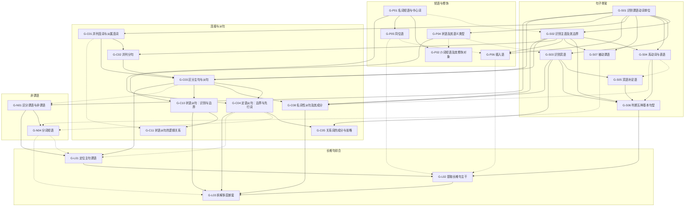

# 语法知识图谱 v0（草稿）

> 本文件由 `scripts/render_grammar_graph_review.py` 从 `data/grammar_graph/grammar_graph_v0.json` 生成，请勿手改；改 JSON 后重新运行脚本。

草稿。三条关键依赖已由老师确认（标 confirmed_by: teacher），其余由 Claude 判断，老师可以随时推翻。改完运行 scripts/render_grammar_graph_review.py 重新生成审核文档。

以 Reading Study 句子解析的 35 个封闭语法概念（api/reading_study_glossary.py 的 CONCEPTS）为底，整理成可诊断的能力知识点。
知识点 + 带 hard/soft 强度和理由的依赖边，借鉴 Marble Skill Taxonomy 的结构；没有使用 Marble 的数据或文本。

**审核要点：**

1. 每个知识点的粒度是否合适：太粗的拆开，太细的合并。
2. 每条硬依赖是否真的是“不会前者就学不会后者”；拿不准的改成软依赖。
3. 第一阶段范围是否合适。
4. 常见错误是否符合学生的实际情况。
5. 是否缺了重要的知识点。

## 审核记录

- 2026-10-18 · 老师：确认“判断五种基本句型”必须先学“宾语补足语”、“定语从句”必须先学“名词短语中心词”；“区分主句与从句”对“并列分句”从最好先学改为必须先学，因为雅思学生要先把 and / but 连接的句子学透。
- 2026-10-18 · Claude：状语从句拆成“识别与边界”和“逻辑关系”两个知识点；同位语、插入语移入第一阶段；并列分句补充“判断 and 连接的是什么”的证据；名词性从句补充“省略 that”的常见错误。其余审核项交由 Claude 判断。
- 2026-10-18 · Claude：随机抽查 30 个复杂句的标注：从句边界（12 个定语从句、8 个名词性从句）全部正确；约 1/10 的句子有影响答案的错误（主语边界多划了介词短语、祈使句或冒号后的独立句被标成状语从句）；另有 2 句原文本身是残句；约 1/4 的谓语标注连宾语一起划了进来；按“最近的前一个成分”找先行词会出错。因此 G-S01、G-C04、G-L01 的题源改为“部分可自动”：谓语要先收窄到动词本身，先行词需要人工或另一套规则确认。结论：自动生成的题必须经过过滤和人工抽检后再入库，不能直接给学生做。

## 总览

- 知识点 **39** 个：第一阶段 25 个，第二阶段 14 个
- 依赖 **90** 条：硬依赖 65 条，软依赖 25 条

| 模块 | 知识点数 | 第一阶段 |
|---|---:|---:|
| M1 句子骨架 | 7 | 7 |
| M2 短语与修饰 | 6 | 5 |
| M3 连接与从句 | 11 | 8 |
| M4 非谓语 | 5 | 2 |
| M5 特殊句式 | 5 | 0 |
| M6 引述与衔接 | 2 | 0 |
| M7 长难句综合 | 3 | 3 |

## 第一阶段依赖图

实线为硬依赖，虚线为软依赖；箭头从前置知识点指向后续知识点。

## 知识点清单

### M1 句子骨架（Sentence core）

#### G-S01 识别谓语动词单位（Identify the finite verb unit）

- **阶段**：第一阶段 · **题源**：部分可自动，7,752 句真题（标注概念：verb_phrase）
- **学习目标**：在简单句中点出完整的谓语动词单位，包括助动词、情态动词组成的复合谓语。
- **掌握证据**：在简单句中点出完整谓语（may have been done 算一个单位）；不把名词、形容词或介词短语里的词误当成谓语
- **常见错误**：只点实义动词，漏掉助动词或情态动词；把 -ing / -ed 形式误认为谓语
- **题型**：点选成分
- **前置**：无（起点）
- **后续**：G-S02 识别主语及其边界、G-S03 识别宾语、G-S04 系动词与表语、G-S07 被动谓语、G-P04 状语及其语义类型、G-P06 插入语、G-C01 并列连词与从属连词、G-C03 区分主句与从句、G-N01 区分谓语与非谓语、G-X04 倒装、G-X05 比较结构与省略补全、G-D01 引述框架

#### G-S02 识别主语及其边界（Identify the subject and its span）

- **阶段**：第一阶段 · **题源**：可自动出题，8,760 句真题（标注概念：subject）
- **学习目标**：找到谓语的发出者（被动句中为承受者），划出包括后置修饰在内的完整主语。
- **掌握证据**：划出带后置修饰的长主语（the inhabitants of ... in north-western India）；指出主语的中心名词
- **常见错误**：只划中心名词，漏掉后置修饰；把句首介词短语或状语当成主语
- **题型**：点选成分、划出边界
- **前置**：
  - [硬] G-S01 识别谓语动词单位：先锁定谓语，再往前找它的发出者
  - [软] G-P01 名词短语与中心词：长主语的边界要靠名词短语的中心词来判断
- **后续**：G-S04 系动词与表语、G-S06 判断五种基本句型、G-S07 被动谓语、G-P06 插入语、G-C02 并列分句、G-C03 区分主句与从句、G-C08 名词性从句及其成分、G-N03 动名词作主语和宾语、G-N05 独立主格、G-X01 There be 存现句、G-X02 形式主语 it、G-X04 倒装、G-D01 引述框架

#### G-S03 识别宾语（Identify the object）

- **阶段**：第一阶段 · **题源**：可自动出题，1,688 句真题（标注概念：object）
- **学习目标**：找出及物动词的宾语，并与状语区分开。
- **掌握证据**：点出谓语后的宾语；区分宾语与时间、地点状语（developed a method during the dry season）
- **常见错误**：把介词短语或时间状语当成宾语
- **题型**：点选成分
- **前置**：
  - [硬] G-S01 识别谓语动词单位：宾语是谓语动作的对象，先要找到谓语
  - [软] G-P04 状语及其语义类型：区分宾语和状语时需要知道状语是什么
- **后续**：G-S05 宾语补足语、G-S06 判断五种基本句型、G-C05 关系词的成分与省略、G-C08 名词性从句及其成分、G-N03 动名词作主语和宾语

#### G-S04 系动词与表语（Linking verbs and predicatives）

- **阶段**：第一阶段 · **题源**：部分可自动，1,380 句真题（标注概念：linking_verb、predicative、complement）
- **学习目标**：识别 be / seem / become / remain 等系动词及其后的表语，理解“主系表”是在说明主语是什么、怎么样。
- **掌握证据**：点出系动词和表语；区分表语与宾语（is surprising 对比 found a method）
- **常见错误**：把“系动词 + 分词形容词”误认为被动；把表语当成宾语
- **题型**：点选成分、判断类型
- **前置**：
  - [硬] G-S01 识别谓语动词单位：系动词本身就是谓语动词单位
  - [硬] G-S02 识别主语及其边界：表语说明的是主语，要先找到主语
- **后续**：G-S05 宾语补足语、G-S06 判断五种基本句型、G-P03 形容词短语（含后置）、G-C08 名词性从句及其成分、G-X01 There be 存现句

#### G-S05 宾语补足语（Object complements）

- **阶段**：第一阶段 · **题源**：部分可自动，949 句真题（标注概念：object_complement、complement）
- **学习目标**：识别补充说明宾语状态或身份的成分，理解“主谓宾宾补”句型。
- **掌握证据**：在 make / keep / find / consider + 宾语 + 补语结构中点出宾补；说明去掉宾补后句意为何不完整
- **常见错误**：把宾补当作宾语的定语
- **题型**：点选成分、判断类型
- **前置**：
  - [硬] G-S03 识别宾语：宾补说明的是宾语，要先找到宾语
  - [软] G-S04 系动词与表语：宾补和表语同属“补语”，理解表语有助于理解宾补
- **后续**：G-S06 判断五种基本句型

#### G-S06 判断五种基本句型（Five basic sentence patterns）

- **阶段**：第一阶段 · **题源**：部分可自动，派生能力，无直接标注
- **学习目标**：判断一个简单句或主句属于主谓、主谓宾、主谓双宾、主谓宾宾补、主系表中的哪一种。
- **掌握证据**：给出主干，判断句型；说明判断依据：谓语后面接了什么
- **常见错误**：把状语当成宾语，导致句型判断错误
- **题型**：判断类型
- **前置**：
  - [硬] G-S02 识别主语及其边界：五种句型都以主语和谓语为前提
  - [硬] G-S03 识别宾语：要判断谓语后接的是不是宾语
  - [硬] G-S04 系动词与表语：主系表是五种句型之一
  - [硬·老师已确认] G-S05 宾语补足语：主谓宾宾补是五种句型之一
- **后续**：G-L02 提取长难句主干

#### G-S07 被动谓语（Passive predicates）

- **阶段**：第一阶段 · **题源**：部分可自动，610 句真题（标注概念：passive_predicate）
- **学习目标**：识别“be + 过去分词”构成的被动谓语，理解此时主语是动作的承受者。
- **掌握证据**：点出被动谓语（含 have been found、can be seen 等复合形式）；说明主语与动作的关系
- **常见错误**：把“系动词 + 分词形容词”（is interested）与被动混淆；把后置过去分词定语当成被动谓语
- **题型**：点选成分、判断类型
- **语法 60 题包**：22 被动语态形式与用途
- **前置**：
  - [硬] G-S01 识别谓语动词单位：被动谓语仍然是一个谓语动词单位
  - [硬] G-S02 识别主语及其边界：要判断主语是动作的发出者还是承受者
- **后续**：G-N04 分词短语

### M2 短语与修饰（Phrases and modifiers）

#### G-P01 名词短语与中心词（Noun phrases and head nouns）

- **阶段**：第一阶段 · **题源**：部分可自动，35 句真题（标注概念：noun_phrase）
- **学习目标**：找出名词短语的中心词，区分前置修饰和后置修饰。
- **掌握证据**：指出长名词短语的中心词（the alarming rate of loss → rate）；分别标出前置和后置修饰语
- **常见错误**：把 of 后面的名词当成中心词，导致主谓一致判断出错
- **题型**：点选成分
- **语法 60 题包**：12 名词加介词短语
- **前置**：无（起点）
- **后续**：G-S02 识别主语及其边界、G-P02 介词短语及其修饰对象、G-P03 形容词短语（含后置）、G-P05 同位语、G-C04 定语从句：边界与先行词、G-N02 不定式的功能

#### G-P02 介词短语及其修饰对象（Prepositional phrases）

- **阶段**：第一阶段 · **题源**：可自动出题，2,638 句真题（标注概念：prepositional_phrase）
- **学习目标**：识别介词短语，判断它修饰前面的名词（作定语）还是修饰动词或整句（作状语）。
- **掌握证据**：划出介词短语；判断其修饰对象
- **常见错误**：把介词短语里的名词当成主语或宾语
- **题型**：划出边界、判断类型
- **语法 60 题包**：12 名词加介词短语、19 介词短语
- **前置**：
  - [硬] G-P01 名词短语与中心词：介词短语的核心是“介词 + 名词短语”
  - [软] G-P04 状语及其语义类型：介词短语作状语时需要理解状语的功能
- **后续**：G-C07 介词 + 关系代词

#### G-P03 形容词短语（含后置）（Adjective phrases）

- **阶段**：第二阶段 · **题源**：部分可自动，125 句真题（标注概念：adjective_phrase）
- **学习目标**：识别以形容词为核心的短语，理解它带补充成分变长后为何要后置（a task difficult to finish）。
- **掌握证据**：点出形容词短语及其修饰的名词；解释后置原因
- **常见错误**：把后置形容词短语误当成表语
- **题型**：点选成分、判断类型
- **语法 60 题包**：10 形容词与分词形容词
- **前置**：
  - [硬] G-P01 名词短语与中心词：形容词短语修饰的是名词
  - [软] G-S04 系动词与表语：形容词短语也常作表语

#### G-P04 状语及其语义类型（Adverbials）

- **阶段**：第一阶段 · **题源**：可自动出题，2,270 句真题（标注概念：adverbial）
- **学习目标**：识别给动作或整句补充时间、地点、方式、原因、程度等信息的状语，并判断其语义类型。
- **掌握证据**：点出状语；判断状语表示时间、地点、方式、原因还是目的
- **常见错误**：把状语误认为宾语
- **题型**：点选成分、判断类型
- **语法 60 题包**：10 方式、地点、时间与频率副词
- **前置**：
  - [硬] G-S01 识别谓语动词单位：状语修饰的是谓语或整句
- **后续**：G-S03 识别宾语、G-P02 介词短语及其修饰对象、G-C10 状语从句：识别与边界、G-N02 不定式的功能

#### G-P05 同位语（Apposition）

- **阶段**：第一阶段 · **题源**：可自动出题，1,054 句真题（标注概念：apposition）
- **学习目标**：识别紧跟在名词后面、把它再解释一遍的成分。
- **掌握证据**：点出同位语及它解释的名词；区分同位语与并列名词
- **常见错误**：把同位语当成另一个并列的主语
- **题型**：点选成分、判断类型
- **前置**：
  - [硬] G-P01 名词短语与中心词：同位语解释的是名词
- **后续**：G-P06 插入语、G-C06 限制性与非限制性定语从句、G-C09 同位语从句与定语从句的区分、G-L02 提取长难句主干

#### G-P06 插入语（Parenthesis）

- **阶段**：第一阶段 · **题源**：可自动出题，512 句真题（标注概念：parenthesis）
- **学习目标**：识别用逗号、破折号或括号插入的补充说明，读主干时能先跳过它。
- **掌握证据**：划出插入语；去掉插入语后确认主干仍然完整
- **常见错误**：把插入语里的动词当成主句谓语
- **题型**：划出边界
- **前置**：
  - [硬] G-S01 识别谓语动词单位：跳过插入语的目的是看清主谓
  - [硬] G-S02 识别主语及其边界：插入语常把主语和谓语隔开
  - [软] G-P05 同位语：同位语和插入语都用标点隔开，需要区分
- **后续**：G-L02 提取长难句主干

### M3 连接与从句（Linking and clauses）

#### G-C01 并列连词与从属连词（Coordinating vs subordinating conjunctions）

- **阶段**：第一阶段 · **题源**：部分可自动，47 句真题（标注概念：conjunction）
- **学习目标**：判断连接词是连接平级成分（and / but / or），还是引出从句（because / although / when / if）。
- **掌握证据**：给出连接词，判断是并列还是从属；说明它连接的是词、短语还是分句
- **常见错误**：把 while / since 等多义连接词只理解成一种意思
- **题型**：判断类型
- **语法 60 题包**：23 并列与从属连词
- **前置**：
  - [硬] G-S01 识别谓语动词单位：判断是否连接分句，要先能数出动词单位
- **后续**：G-C02 并列分句、G-C03 区分主句与从句、G-C11 状语从句的逻辑关系、G-D02 连接副词与逻辑衔接

#### G-C02 并列分句（Coordinate clauses）

- **阶段**：第一阶段 · **题源**：可自动出题，1,612 句真题（标注概念：coordinate_clause）
- **学习目标**：识别用 and / but / or 连接的平级分句，判断 and 连接的到底是两个分句、两个谓语还是两个词组，并分别找出各分句的主谓。
- **掌握证据**：拆出两个平级分句；分别点出每个分句的谓语；判断 and / but 连接的是两个分句、两个谓语还是两个词组
- **常见错误**：把共用主语的并列谓语误当成两个分句；看到 and 就断句，把 A and B 这样的并列名词拆成两个分句
- **题型**：划出边界、点选成分
- **前置**：
  - [硬] G-C01 并列连词与从属连词：并列分句靠并列连词连接
  - [硬] G-S02 识别主语及其边界：要分别找出每个分句的主语
- **后续**：G-C03 区分主句与从句

#### G-C03 区分主句与从句（Main vs subordinate clauses）

- **阶段**：第一阶段 · **题源**：可自动出题，派生能力，无直接标注
- **学习目标**：理解从句有自己的谓语、由引导词引出、在主句中充当一个成分，能判断某个分句是主句还是从句。
- **掌握证据**：在复合句中指出哪个分句是主句；说明从句由哪个词引导
- **常见错误**：把从句谓语当成主句谓语（The students who completed the survey reported… 中选 completed）
- **题型**：判断类型、点选成分
- **前置**：
  - [硬] G-S01 识别谓语动词单位：判断分句的依据是动词单位
  - [硬] G-S02 识别主语及其边界：每个分句都有自己的主语
  - [硬] G-C01 并列连词与从属连词：从句由从属连词或关系词引出
  - [硬·老师已确认] G-C02 并列分句：雅思学生要先把 and / but 连接的平级分句学透，再学主从句
- **后续**：G-C04 定语从句：边界与先行词、G-C08 名词性从句及其成分、G-C10 状语从句：识别与边界、G-N01 区分谓语与非谓语、G-X03 强调句 It is … that、G-L01 定位主句谓语

#### G-C04 定语从句：边界与先行词（Relative clauses: span and antecedent）

- **阶段**：第一阶段 · **题源**：部分可自动，2,671 句真题（标注概念：relative_clause）
- **学习目标**：识别定语从句，划出它的起止位置，并找到它修饰的先行词。
- **掌握证据**：划出定语从句的起止位置；指出先行词
- **常见错误**：从句终点划过头，把主句谓语划进从句；把离得最近的名词当成先行词（the rate of loss of rainforests that…）
- **题型**：划出边界、点选成分
- **语法 60 题包**：20 限定性定语从句
- **前置**：
  - [硬] G-C03 区分主句与从句：定语从句是从句的一种
  - [硬·老师已确认] G-P01 名词短语与中心词：先行词是名词，要先会找名词短语的中心词
- **后续**：G-C05 关系词的成分与省略、G-C06 限制性与非限制性定语从句、G-N04 分词短语、G-L01 定位主句谓语、G-L03 拆解多层嵌套

#### G-C05 关系词的成分与省略（Role of the relative word and omission）

- **阶段**：第一阶段 · **题源**：部分可自动，派生能力，无直接标注
- **学习目标**：判断 who / whom / which / that / whose / where / when 在从句中作主语、宾语还是状语，并据此判断能否省略。
- **掌握证据**：说明关系词在从句中的成分；识别省略了关系词的定语从句（the book I read）
- **常见错误**：以为所有关系词都可以省略
- **题型**：判断类型、人工出题
- **语法 60 题包**：20 限定性定语从句
- **前置**：
  - [硬] G-C04 定语从句：边界与先行词：要先找到定语从句和关系词
  - [硬] G-S03 识别宾语：能否省略取决于关系词是不是从句的宾语
- **后续**：G-C07 介词 + 关系代词、G-C09 同位语从句与定语从句的区分

#### G-C06 限制性与非限制性定语从句（Defining vs non-defining relative clauses）

- **阶段**：第二阶段 · **题源**：部分可自动，派生能力，无直接标注
- **学习目标**：根据逗号和语义区分限制性与非限制性定语从句，理解 which 指代前面整句的情况。
- **掌握证据**：判断定语从句是否限制先行词的范围；识别 which 指代整句
- **常见错误**：在非限制性定语从句中使用 that
- **题型**：判断类型
- **语法 60 题包**：20 非限定性定语从句
- **前置**：
  - [硬] G-C04 定语从句：边界与先行词：要先能识别定语从句
  - [软] G-P05 同位语：非限制性定语从句和同位语一样靠逗号隔开

#### G-C07 介词 + 关系代词（Preposition + relative pronoun）

- **阶段**：第二阶段 · **题源**：部分可自动，派生能力，无直接标注
- **学习目标**：理解 in which / of whom 等结构，能还原介词原本搭配的词。
- **掌握证据**：把“介词 + 关系代词”还原成从句里的原位置；选择正确的介词
- **常见错误**：介词搭配错误
- **题型**：人工出题
- **语法 60 题包**：20 介词与简化定语从句
- **前置**：
  - [硬] G-C05 关系词的成分与省略：要知道关系词在从句中的成分
  - [硬] G-P02 介词短语及其修饰对象：介词 + 关系代词本质上是介词短语前移

#### G-C08 名词性从句及其成分（Noun clauses）

- **阶段**：第一阶段 · **题源**：可自动出题，2,496 句真题（标注概念：noun_clause）
- **学习目标**：识别名词性从句，判断它在句中作主语、宾语、表语还是同位语。
- **掌握证据**：划出名词性从句；判断它在句中的成分
- **常见错误**：把 that 引导的名词性从句当成定语从句；宾语从句省略 that 后找不到从句起点（The study found most patients…）
- **题型**：划出边界、判断类型
- **语法 60 题包**：21 it 从句与 what 从句
- **前置**：
  - [硬] G-C03 区分主句与从句：名词性从句是从句的一种
  - [硬] G-S02 识别主语及其边界：名词性从句可以作主语
  - [硬] G-S03 识别宾语：名词性从句最常见的是作宾语
  - [软] G-S04 系动词与表语：名词性从句也能作表语
- **后续**：G-C09 同位语从句与定语从句的区分、G-X02 形式主语 it、G-D01 引述框架、G-L03 拆解多层嵌套

#### G-C09 同位语从句与定语从句的区分（Appositive vs relative that-clauses）

- **阶段**：第二阶段 · **题源**：需人工出题，派生能力，无直接标注
- **学习目标**：区分 the fact that… 中的 that 从句是在解释 fact 的内容（同位语从句），还是在修饰 fact（定语从句）。
- **掌握证据**：判断 that 从句类型，并说明依据：that 在从句中是否充当成分
- **常见错误**：只看 that 前面有没有名词就判断为定语从句
- **题型**：判断类型、人工出题
- **前置**：
  - [硬] G-C08 名词性从句及其成分：同位语从句是名词性从句的一种
  - [硬] G-C05 关系词的成分与省略：区分依据是 that 在从句中是否充当成分
  - [软] G-P05 同位语：同位语从句和同位语一样是在解释名词

#### G-C10 状语从句：识别与边界（Adverbial clauses: span）

- **阶段**：第一阶段 · **题源**：可自动出题，2,664 句真题（标注概念：adverbial_clause）
- **学习目标**：识别状语从句，划出它的起止位置，并找到它依附的主句。
- **掌握证据**：划出状语从句的起止位置；指出它依附的主句
- **常见错误**：句首状语从句后没有逗号时，把从句结尾和主句开头混在一起
- **题型**：划出边界
- **语法 60 题包**：23 并列与从属连词
- **前置**：
  - [硬] G-C03 区分主句与从句：状语从句是从句的一种
  - [硬] G-P04 状语及其语义类型：状语从句是一个“大状语”，要先理解状语的语义类型
- **后续**：G-C11 状语从句的逻辑关系、G-X05 比较结构与省略补全、G-L03 拆解多层嵌套

#### G-C11 状语从句的逻辑关系（Adverbial clauses: logical relation）

- **阶段**：第一阶段 · **题源**：可自动出题，2,664 句真题（标注概念：adverbial_clause）
- **学习目标**：判断状语从句表示时间、原因、条件、让步、对比、目的还是结果，尤其分清让步和对比（although / while / whereas）。
- **掌握证据**：判断状语从句的逻辑类型；说明同一个连接词在不同句子里的意思（while 表时间还是对比，since 表时间还是原因）
- **常见错误**：把表对比的 while 当成时间；把表原因的 since 当成时间；忽略让步关系，误判作者的真实观点
- **题型**：判断类型
- **语法 60 题包**：17 零条件句与第一条件句、17 第二条件句、18 第三条件句、18 混合条件句、23 并列与从属连词
- **前置**：
  - [硬] G-C10 状语从句：识别与边界：要先找到状语从句，才能判断它表示什么关系
  - [软] G-C01 并列连词与从属连词：while / since 等连接词有多种意思，理解连接词有帮助

### M4 非谓语（Non-finite forms）

#### G-N01 区分谓语与非谓语（Finite vs non-finite verbs）

- **阶段**：第一阶段 · **题源**：可自动出题，709 句真题（标注概念：non_finite_clause）
- **学习目标**：理解“一句一个动词单位”，能区分句中的谓语动词与 to do / doing / done 等非谓语形式。
- **掌握证据**：在含多个动词形式的句子中指出哪些是非谓语；说明非谓语在句中起什么作用
- **常见错误**：把非谓语当成谓语，以为一句话有两个谓语
- **题型**：判断类型、点选成分
- **前置**：
  - [硬] G-S01 识别谓语动词单位：要先知道什么是谓语动词单位
  - [软] G-C03 区分主句与从句：多出来的动词要么进从句、要么变非谓语，两者一起理解更完整
- **后续**：G-N02 不定式的功能、G-N03 动名词作主语和宾语、G-N04 分词短语、G-L01 定位主句谓语

#### G-N02 不定式的功能（Infinitives）

- **阶段**：第二阶段 · **题源**：部分可自动，694 句真题（标注概念：infinitive_phrase）
- **学习目标**：判断不定式在句中作名词（主语、宾语）、定语还是目的状语。
- **掌握证据**：划出不定式短语；判断其功能
- **常见错误**：把作定语的不定式（measures to reduce pollution）当成目的状语
- **题型**：划出边界、判断类型
- **语法 60 题包**：16 动词加不定式、16 不带 to 的不定式
- **前置**：
  - [硬] G-N01 区分谓语与非谓语：不定式是非谓语的一种
  - [软] G-P01 名词短语与中心词：不定式作定语时修饰名词
  - [软] G-P04 状语及其语义类型：不定式作状语时最常表示目的
- **后续**：G-X02 形式主语 it

#### G-N03 动名词作主语和宾语（Gerunds）

- **阶段**：第二阶段 · **题源**：部分可自动，307 句真题（标注概念：gerund_phrase）
- **学习目标**：识别动名词短语，判断它作主语还是宾语。
- **掌握证据**：点出动名词短语；判断它作主语还是宾语
- **常见错误**：与现在分词混淆
- **题型**：点选成分、判断类型
- **语法 60 题包**：16 动词加 -ing、16 动词加介词再加 -ing
- **前置**：
  - [硬] G-N01 区分谓语与非谓语：动名词是非谓语的一种
  - [硬] G-S02 识别主语及其边界：动名词常作主语
  - [硬] G-S03 识别宾语：动名词常作宾语

#### G-N04 分词短语（Participial phrases）

- **阶段**：第一阶段 · **题源**：可自动出题，2,011 句真题（标注概念：participial_phrase）
- **学习目标**：理解 -ing 表主动或进行、-ed 表被动或完成，判断分词短语是作后置定语还是作状语。
- **掌握证据**：划出分词短语；判断它修饰名词还是交代背景；把后置分词还原成定语从句（the results published → that were published）
- **常见错误**：把后置过去分词当成主句谓语（The results published last year showed… 中选 published）
- **题型**：划出边界、判断类型
- **语法 60 题包**：10 形容词与分词形容词、12 分词与不定式名词短语
- **前置**：
  - [硬] G-N01 区分谓语与非谓语：分词是非谓语的一种
  - [软] G-S07 被动谓语：-ed 分词表被动，理解被动谓语有帮助
  - [软] G-C04 定语从句：边界与先行词：后置分词可以看作简化的定语从句
- **后续**：G-N05 独立主格、G-L01 定位主句谓语、G-L03 拆解多层嵌套

#### G-N05 独立主格（Absolute constructions）

- **阶段**：第二阶段 · **题源**：部分可自动，135 句真题（标注概念：absolute）
- **学习目标**：识别“名词 + 分词或介词短语”独立给整句补充背景的结构，找到它的逻辑主语。
- **掌握证据**：划出独立主格结构；指出它的逻辑主语
- **常见错误**：把独立主格里的名词当成句子主语
- **题型**：划出边界、点选成分
- **前置**：
  - [硬] G-N04 分词短语：独立主格的核心常是分词
  - [硬] G-S02 识别主语及其边界：要区分独立主格的逻辑主语和句子主语

### M5 特殊句式（Special structures）

#### G-X01 There be 存现句（Existential there）

- **阶段**：第二阶段 · **题源**：可自动出题，198 句真题（标注概念：existential_clause）
- **学习目标**：理解 there 只是占位，真正的主语在 be 后面。
- **掌握证据**：指出 there be 句的真主语；根据真主语判断 be 的单复数
- **常见错误**：把 there 当成主语
- **题型**：点选成分
- **前置**：
  - [硬] G-S02 识别主语及其边界：要找出 be 后面的真主语
  - [软] G-S04 系动词与表语：there be 里的 be 也是系动词形式

#### G-X02 形式主语 it（Formal subject it）

- **阶段**：第二阶段 · **题源**：部分可自动，65 句真题（标注概念：formal_subject）
- **学习目标**：识别 it 占主语位置、真主语（不定式或从句）后置的结构，并找到真主语。
- **掌握证据**：指出形式主语句的真主语；把真主语放回主语位置改写句子
- **常见错误**：把 it 理解成指代前文的代词
- **题型**：点选成分、人工出题
- **语法 60 题包**：21 形式主语 it
- **前置**：
  - [硬] G-S02 识别主语及其边界：要区分形式主语和真主语
  - [软] G-N02 不定式的功能：真主语常是不定式
  - [软] G-C08 名词性从句及其成分：真主语常是名词性从句
- **后续**：G-X03 强调句 It is … that

#### G-X03 强调句 It is … that（Cleft sentences）

- **阶段**：第二阶段 · **题源**：部分可自动，56 句真题（标注概念：cleft）
- **学习目标**：识别 It is … that … 强调结构，找到被强调的成分，并与形式主语句区分。
- **掌握证据**：指出被强调的成分；去掉 It is … that 后还原句子，以此与形式主语句区分
- **常见错误**：把强调句当成形式主语句
- **题型**：点选成分、人工出题
- **前置**：
  - [硬] G-X02 形式主语 it：强调句和形式主语句外形相似，必须能区分
  - [硬] G-C03 区分主句与从句：要识别 that 后面的部分不是独立的主句

#### G-X04 倒装（Inversion）

- **阶段**：第二阶段 · **题源**：部分可自动，47 句真题（标注概念：inversion）
- **学习目标**：识别否定词或 only 开头等引起的倒装，还原正常语序。
- **掌握证据**：指出倒装句中的主语和提前的助动词；把倒装句还原成正常语序
- **常见错误**：倒装后找错主语
- **题型**：点选成分、人工出题
- **前置**：
  - [硬] G-S01 识别谓语动词单位：要知道正常语序中谓语的位置
  - [硬] G-S02 识别主语及其边界：倒装后要重新找到主语

#### G-X05 比较结构与省略补全（Comparatives and ellipsis）

- **阶段**：第二阶段 · **题源**：部分可自动，217 句真题（标注概念：comparative）
- **学习目标**：理解 than / as … as 引导的比较，并补全比较对象后省略的部分。
- **掌握证据**：指出比较的双方；补全 than 后省略的成分
- **常见错误**：比较对象不对等（把 A 的某属性和 B 本身比较）
- **题型**：判断类型、人工出题
- **语法 60 题包**：11 比较级与最高级、11 其他比较结构
- **前置**：
  - [硬] G-S01 识别谓语动词单位：补全省略要知道省掉的是哪部分谓语
  - [软] G-C10 状语从句：识别与边界：than 引导的部分本质上是比较状语从句

### M6 引述与衔接（Reporting and cohesion）

#### G-D01 引述框架（Reporting frames）

- **阶段**：第二阶段 · **题源**：可自动出题，580 句真题（标注概念：reporting_clause、direct_speech、attribution）
- **学习目标**：识别 says Professor X、the study suggests、according to … 等引述成分，把说话人和被引用的内容分开。
- **掌握证据**：划出引述句或引述来源；指出被引用内容的主干
- **常见错误**：把引述句当成句子主干，忽略真正的观点
- **题型**：划出边界、判断类型
- **语法 60 题包**：15 转述动词、15 间接引语与时态变化
- **前置**：
  - [硬] G-S01 识别谓语动词单位：引述句本身有谓语（says / suggests）
  - [硬] G-S02 识别主语及其边界：要找出说话人
  - [软] G-C08 名词性从句及其成分：the study suggests that… 后面是宾语从句

#### G-D02 连接副词与逻辑衔接（Discourse markers）

- **阶段**：第二阶段 · **题源**：可自动出题，393 句真题（标注概念：discourse_marker）
- **学习目标**：判断 however / therefore / moreover 表示的逻辑关系，理解它们是副词、不能像连词一样直接连接两个句子。
- **掌握证据**：判断连接副词表示转折、因果还是递进；判断标点使用是否正确（分号或句号 + however + 逗号）
- **常见错误**：用逗号直接把 however 前后两个句子连起来
- **题型**：判断类型
- **语法 60 题包**：23 连接副词与连接介词
- **前置**：
  - [硬] G-C01 并列连词与从属连词：要先理解连词，才能区分连接副词和连词

### M7 长难句综合（Complex-sentence integration）

#### G-L01 定位主句谓语（Locate the main-clause verb）

- **阶段**：第一阶段 · **题源**：部分可自动，派生能力，无直接标注
- **学习目标**：在含从句或非谓语的句子中，排除从句里的动词和非谓语，找到主句谓语。
- **掌握证据**：从多个候选动词中点出主句谓语；说明其他动词为什么不是（属于哪个从句或非谓语）
- **常见错误**：选从句谓语（completed 对比 reported）；选后置分词（published 对比 showed）
- **题型**：点选成分
- **前置**：
  - [硬] G-C03 区分主句与从句：要先能区分主句和从句
  - [硬] G-N01 区分谓语与非谓语：要先能区分谓语和非谓语
  - [软] G-C04 定语从句：边界与先行词：定语从句是主语后最常见的干扰来源
  - [软] G-N04 分词短语：后置分词是另一个常见干扰来源
- **后续**：G-L02 提取长难句主干

#### G-L02 提取长难句主干（Extract the sentence skeleton）

- **阶段**：第一阶段 · **题源**：可自动出题，3,351 句真题（标注概念：main_clause）
- **学习目标**：把长难句压缩到“主语 + 谓语 + 宾语或表语”，说出这句话的核心意思。
- **掌握证据**：写出或选出句子主干；用一句中文概括主干意思
- **常见错误**：把修饰成分留在主干里；主干缺宾语或表语
- **题型**：提取主干
- **前置**：
  - [硬] G-L01 定位主句谓语：主干以主句谓语为中心
  - [硬] G-S06 判断五种基本句型：主干一定是五种基本句型之一
  - [软] G-P06 插入语：先跳过插入语更容易看清主干
  - [软] G-P05 同位语：先跳过同位语更容易看清主干
- **后续**：G-L03 拆解多层嵌套

#### G-L03 拆解多层嵌套（Untangle nested structures）

- **阶段**：第一阶段 · **题源**：可自动出题，派生能力，无直接标注
- **学习目标**：处理从句套从句、从句里再含非谓语等三层及以上的嵌套，说清每一层修饰谁。
- **掌握证据**：标出每个修饰层的起止位置；说明每一层修饰的对象
- **常见错误**：只拆出第一层，内层修饰对象判断错误
- **题型**：划出边界、判断类型
- **前置**：
  - [硬] G-L02 提取长难句主干：先拆出主干，再逐层处理修饰
  - [硬] G-C04 定语从句：边界与先行词：嵌套中最常见的是定语从句
  - [硬] G-C08 名词性从句及其成分：嵌套中常出现名词性从句
  - [硬] G-C10 状语从句：识别与边界：嵌套中常出现状语从句
  - [软] G-N04 分词短语：分词短语也常出现在嵌套中

## 句子解析概念与知识点对照

词表共 36 个 key：35 个语法概念加 1 个小标题。

| 概念 | 中文 | 含该概念的句子 | 对应知识点 |
|---|---|---:|---|
| `subject` | 主语 | 8,760（68.7%） | G-S02 识别主语及其边界 |
| `verb_phrase` | 谓语 | 7,752（60.8%） | G-S01 识别谓语动词单位 |
| `object` | 宾语 | 1,688（13.2%） | G-S03 识别宾语 |
| `predicative` | 表语 | 404（3.2%） | G-S04 系动词与表语 |
| `object_complement` | 宾语补足语 | 216（1.7%） | G-S05 宾语补足语 |
| `complement` | 补语 | 738（5.8%） | G-S04 系动词与表语、G-S05 宾语补足语 |
| `main_clause` | 主句 | 3,351（26.3%） | G-L02 提取长难句主干 |
| `coordinate_clause` | 并列分句 | 1,612（12.6%） | G-C02 并列分句 |
| `relative_clause` | 定语从句 | 2,671（21.0%） | G-C04 定语从句：边界与先行词 |
| `noun_clause` | 名词性从句 | 2,496（19.6%） | G-C08 名词性从句及其成分 |
| `adverbial_clause` | 状语从句 | 2,664（20.9%） | G-C10 状语从句：识别与边界、G-C11 状语从句的逻辑关系 |
| `prepositional_phrase` | 介词短语 | 2,638（20.7%） | G-P02 介词短语及其修饰对象 |
| `participial_phrase` | 分词短语 | 2,011（15.8%） | G-N04 分词短语 |
| `infinitive_phrase` | 不定式 | 694（5.4%） | G-N02 不定式的功能 |
| `gerund_phrase` | 动名词 | 307（2.4%） | G-N03 动名词作主语和宾语 |
| `non_finite_clause` | 非谓语结构 | 709（5.6%） | G-N01 区分谓语与非谓语 |
| `apposition` | 同位语 | 1,054（8.3%） | G-P05 同位语 |
| `parenthesis` | 插入语 | 512（4.0%） | G-P06 插入语 |
| `adverbial` | 状语 | 2,270（17.8%） | G-P04 状语及其语义类型 |
| `linking_verb` | 系动词 | 506（4.0%） | G-S04 系动词与表语 |
| `passive_predicate` | 被动谓语 | 610（4.8%） | G-S07 被动谓语 |
| `existential_clause` | 存现句 There be | 198（1.6%） | G-X01 There be 存现句 |
| `reporting_clause` | 引述句 | 501（3.9%） | G-D01 引述框架 |
| `direct_speech` | 直接引语 | 172（1.3%） | G-D01 引述框架 |
| `attribution` | 引述来源 | 14（0.1%） | G-D01 引述框架 |
| `discourse_marker` | 连接副词 | 393（3.1%） | G-D02 连接副词与逻辑衔接 |
| `conjunction` | 连接词 | 47（0.4%） | G-C01 并列连词与从属连词 |
| `formal_subject` | 形式主语 it | 65（0.5%） | G-X02 形式主语 it |
| `absolute` | 独立主格 | 135（1.1%） | G-N05 独立主格 |
| `comparative` | 比较结构 | 217（1.7%） | G-X05 比较结构与省略补全 |
| `cleft` | 强调结构 | 56（0.4%） | G-X03 强调句 It is … that |
| `inversion` | 倒装 | 47（0.4%） | G-X04 倒装 |
| `adjective_phrase` | 形容词短语 | 125（1.0%） | G-P03 形容词短语（含后置） |
| `noun_phrase` | 名词短语 | 35（0.3%） | G-P01 名词短语与中心词 |
| `generic_phrase` | 短语 | 272（2.1%） | 不纳入：解析器的兜底标签，不对应一项具体能力 |
| `heading` | 小标题 | 32（0.3%） | 不纳入：原文排版里的小标题，不是句子成分 |

## 自动出题前要处理的标注问题

统计范围：317 篇文章、12,746 句。

1. **被动漏标。** 第 1 层谓语中有 651 条形如“be + 过去分词”却只标成普通谓语，正式标为被动的只有 589 条（粗略规则估计，含少量“系动词 + 形容词”）。只能用已标注的句子出正例题，不能用“没标被动”推断“没有被动”。
2. **层级不是严格包含关系。** 第 2 层成分中只有 3,042 / 12,953 是某个第 1 层成分的子串；多数是按顺序排列、用层级表示依附深度。划边界和找先行词的题需要先把标注整理成树。
3. **主句标注覆盖率低。** 只有 26.3% 的句子带主句标注，提取主干的题应由第 1 层的主语、谓语、宾语或表语拼出，不要依赖主句标注。
4. **疑似异常。** 有 45 个定语从句和 197 个名词性从句标在第 1 层，另有 293 个成分无法归类，上线前需要抽检。
5. **题源稀少的概念。** 引述来源 14 句、名词短语 35 句、连接词 47 句、倒装 47 句、强调结构 56 句、形式主语 it 65 句，需要人工补题。
6. **多层嵌套题源。** 含第 3 层及以上成分的句子有 2,590 句，可作为“拆解多层嵌套”的题源。

## 35 个概念未覆盖的语法

时态与时态选择（语法 60 题包单元 1–6）；情态动词（语法 60 题包单元 13–14）；虚拟语气与愿望句（语法 60 题包单元 18）；省略与替代（语法 60 题包单元 21）；名词数、冠词与限定词（语法 60 题包单元 7–8）；主谓一致。句子解析标注无法为这些内容出题，后续可作为第三阶段知识点，题目来自语法 60 题包或人工出题。
