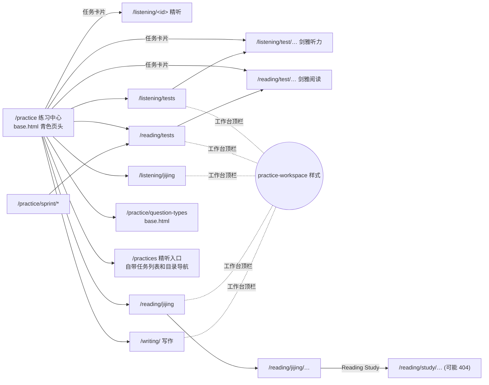

# 刷题网页：跳转、点击与设计审查（2026-11-26）

> 角色：Claude 审查并出方案，Codex 执行。本文不含产品代码改动。
> 基线：`origin/main` = `f81a5e4a`（生产当前版本）。网页背词任务页在 `codex/web-vocabulary-task-page-20261126` 上，未合并，不在本次范围。
> 改版稿：同目录 `practice-center-redesign.html`（练习中心改版方案，含改版前截图对照；浏览器直接打开）。同一份私有 Artifact：https://claude.ai/artifact/DP5XbhauGucJerSNtZnkRv（需用户分享后他人才能打开）。

## 0. 方法与限制

- 在隔离环境用真实 `app.py`、仓库内题库数据和合成 SQLite 启动本地服务。合成数据为 1 名学生、1 名老师、1 名助教；今日 3 条任务（剑雅听力、剑雅阅读、精听），明日 1 条（剑雅阅读）。用 Playwright Chromium 检查：
  - **14 个目录页**，每页分匿名和已确认学生身份两种状态；另有 8 个做题页。
  - **500 个站内链接**逐个请求：498 个 200，1 个 302，1 个 404（见 P0-3）。
  - **12 条跳转流程**：任务卡片、目录、写作、冲刺进入做题页，再点页面上的返回按钮和浏览器后退。
  - **无效点击探测**：点击后监听地址、DOM 变化和请求。
  - 截图：1440×900、1280×800，以及 390×844 手机宽度。
- 环境限制（**不计为缺陷**）：
  - 仓库不含 mp3，做题页音频 404。
  - 沙箱挡住外部 CDN，因此图标字体没有加载。
  - 听力题型专项会跳过缺音频的 Section，本地显示 0 册；阅读为 18 册、216 单元，正常。
  - 不含生产数据，也没有在真机、Safari 上验证。
- 可复现：脚本放在 `docs/reviews/practice-web-audit-20261126/`（`boot.py` 启动，`crawl.js`、`flows.js`、`probe*.js` 检查）。

## 1. 当前页面地图

现状是**三套入口和外观并存**：
- `/practice`（继承 `base.html`，青色条“学习计划与打卡系统”）
- `/practices`（“学生练习入口”，有独立页头、一份重复的任务列表，以及一套“听力/阅读 → 剑雅/机经/精听”导航）
- 工作台式目录（剑雅、机经、写作、冲刺，Sage Path 顶栏）

页面标题也有三种：“学习计划与打卡系统”、“睿然练习系统 · Sage Path”、“xxx · Sage Path”。身份入口在 `/practice` 叫“切换学生”，在 `/practices` 叫“切换账号”。

## 2. 问题清单

### P0：学生直接受影响

| # | 问题 | 证据 | 位置 | 改法 |
|---|---|---|---|---|
| 1 | **练习中心向学生渲染了老师端组件，且没有样式。** 学生会看到一列没加样式的“科目 / 资源类型 / 考试系列”筛选、一块浏览器默认样式的“练习预览”，以及**“布置给学生”按钮（点击后跳到后台登录页）** | 学生访问时，`admin_suite_v2.css` 只对 staff 加载；探测点击“布置给学生”后进入 `/login?next=/tasks` | `templates/practice/index_content.html:586-598`（筛选侧栏、考试切换），`:705-711`（预览面板）；`templates/base.html:20`（CSS 只对 staff 加载） | 这三块包进 ``。学生端用改版稿里的“题库”区块替代 |
| 2 | **确认身份后，姓名输入框和“确认”按钮仍然显示**（与“切换学生”同屏） | `form.hidden === true`，但 computed `display: flex` | `templates/practice/index_content.html:69` 的 `.practice-identity__form { display:flex }` 覆盖了 `[hidden]` | 加 `.practice-identity__form[hidden]{display:none}`；更稳妥的是在该页加 `[hidden]{display:none!important}` |
| 3 | **阅读做题页的“Reading Study”入口无条件显示，套题没有解析时点进去是未加样式的 404** | `/api/reading-study/catalog` 返回空，入口仍可见；点击后为 Flask 默认 Not Found | `static/js/practice_modes.js:147` 按能力写 `node.hidden = !available`，覆盖了 `templates/reading/test_practice.html:1591 revealReadingStudyEntry()` 的“有解析才显示” | 入口改用独立的 gate 属性（如 `data-reveal-when-ready`）。capability 只负责隐藏、不负责显示，显示由 API 决定。`/reading/study/<id>` 没有解析时重定向回做题页，不返回裸 404 |

### P1：跳转逻辑与文案

| # | 问题 | 证据 | 位置 | 改法 |
|---|---|---|---|---|
| 4 | **任务做题页退出确认框用的是模考文案**：“模考会保留当前答案……从任务详情重新进入”。普通听力、阅读任务不是模考，网页上也没有“任务详情”页。而且**没有任何改动也一律拦截** | 三个任务页点返回都弹框，确认后能回到 `/practice`（返回本身正常） | `templates/listening/test_practice.html:1114`、`templates/reading/test_practice.html:577` 的文案；`:2692` 和 `:1630` 的 `confirmExit: Boolean(persistenceContext …)` | 文案按场景区分：任务页写“答案已自动保存，回到任务列表后可继续”，模考保留原文。`confirmExit` 只在有未保存改动或计时进行中时为真；没有改动时直接返回 |
| 5 | **没有返回上下文时，任务页的返回按钮写“返回任务详情”**（小程序概念）。直接打开或从书签进入时会出现 | 直接打开 `/listening/test/…?task_id=…&token=…` 时显示“← 返回任务详情” | `templates/listening/test_practice.html:2691`、`templates/reading/test_practice.html:1629`、`templates/listening/player.html:1172` 的 `fallbackMode: 'task_detail'`；`static/js/practice_shell.js:98` | 网页端 fallback 改为 `practice_library` 并回到任务区（`/practice#practiceAssignedTasks`）。`task_detail` 只在小程序 webview 中使用 |
| 6 | **目录页有两个“← 返回练习中心”**：左侧的品牌标识被脚本替换成返回链接（Sage Path 标志因此消失），右侧还有一个同样的链接 | 剑雅听力、阅读、机经、写作、冲刺各页 | `templates/listening/test_index.html:21`（品牌标识带 `data-practice-module-back`）和 `:33`；其他工作台模板相同 | 品牌标识保持为标志，不改写；只保留一个返回入口，放在右侧，并按来源显示文字（见 #9） |
| 7 | **练习中心自己的页头有“← 返回练习中心”，指向自身** | `/practice` 页头 | `templates/base.html:153`（`data-practice-module-back` 把“练习中心”改写为返回） | 当前就在 `/practice` 时不渲染这个链接 |
| 8 | **无效控件**：“资源类型”“考试系列”5 个复选框没有任何处理代码；“科目”按钮只更新页面最底部的预览，学生看不到任何反馈 | 点击后页面其他部分零变化 | `templates/practice/index_content.html:594-595`；`:1000+` 的脚本只处理 `data-practice-target-index` | 随 #1 一并对学生隐藏。staff 端要么接上真实筛选，要么删除 |
| 9 | **目录页返回不区分来源**：从“阅读考前冲刺”进入剑雅阅读后，返回仍写“返回练习中心” | `practice_source=exam_sprint` 已带在 URL 上，但目录页的返回是固定链接 | 工作台模板的 `data-practice-module-back` | 目录页也用 `practice_shell` 的 `resolveContext` 生成返回文字（做题页已经是这样） |
| 10 | **确认身份后导航参数仍是 guest**：从练习中心进入的链接带 `practice_identity=guest`，退出按钮的文字因此可能不对 | 确认身份后点“进入练习”，URL 中 `practice_identity=guest` | `window.PRACTICE_NAVIGATION_DEFAULTS` 在服务端渲染时就固定了；`index_content.html` 的 `setVerified()` 没有更新它 | `setVerified()` 中同步设置 `identityMode='verified_student'` |
| 11 | **做题页刚打开就显示“已保存”** | 无任何作答时，状态胶囊显示“已保存” | `static/js/practice_shell.js:576`（`initialSaved` 未传时默认“已保存”） | 初始显示“已同步”或不显示；有实际保存后再显示“已保存 hh:mm” |

### P2：设计一致性与美观

| # | 问题 | 位置 | 改法 |
|---|---|---|---|
| 12 | **三套页头和入口并存**（见 §1） | `base.html` 公共页头；`templates/listening/index.html`（`/practices`）；`practice/_workspace_styles.html` | 统一用工作台顶栏：品牌 + 练习中心、听力、阅读、写作、题型专项 + 身份胶囊和退出。`/practices` 只保留精听目录，任务列表交给练习中心 |
| 13 | **练习中心在桌面上是一张约 650px 的窄卡片**，页面长约 3,000px（手机约 4,000px）。精听卡片单独占一行，右侧空着 | `templates/practice/index_content.html` | 见改版稿：顶部为身份和今日任务，中间是题库网格，右栏放我的模考、尚未开放和已完成 |
| 14 | **题型专项的选中态是橙红色**，不在品牌配色里；页头是后台样式的“学习计划与打卡系统” | `templates/question_type_practice/student_index.html` | 选中态改为品牌青色，页头改为工作台顶栏 |
| 15 | **背景水印字与内容重叠**：“SAGEPATH”压在“本册进度”上，竖排“LISTENING / WRITING”压在侧栏条目上 | `_workspace_styles.html` 的 watermark | 水印移到内容区之外，或在 1440 以下隐藏；不能压在可读文字下面 |
| 16 | **外部 CDN 依赖**：`/practice` 和题型专项从 jsDelivr 加载 Bootstrap 4、从 cdnjs 加载 Font Awesome；`/practices` 也依赖 cdnjs。国内网络下这两个 CDN 时常很慢或失败，页面会失去布局或图标 | `templates/base.html:15-17`、`templates/listening/index.html` | 改为本地托管（`static/vendor/`）。学生端页面本来就只用到很少的 Bootstrap 样式，可以逐步去掉 |
| 17 | 写作侧栏子项的缩进和字号不一致（“观点型”与“利弊判断”等同级项不同） | `templates/writing/index.html` 侧栏 | 统一子项样式 |
| 18 | 目录页的 h1 是书名（“剑桥雅思 21”），没有页面级标题；页面 `<title>` 品牌不统一 | 工作台目录模板 | 页面级 h1 用“剑雅听力”等，书名降为 h2；`<title>` 统一为“页面名 · Sage Path” |

### 已确认正常

- 站内链接 498/500 正常（302 是登录跳转，404 见 P0-3）。
- 阅读、听力机经、阅读机经目录进入做题后，点返回和浏览器后退都能回到原目录，并带上来源参数。
- 6 个主要目录页在 390 宽度下无横向溢出；手机版剑雅目录卡片布局良好。
- 任务卡片的分组（助教、老师）、日期锁定（明日任务锁定为“尚未开放”）显示正确。
- 写作题库、剑雅目录的工作台设计完整度高，可以作为统一的基准。

## 3. 优化分批（建议顺序）

| 批次 | 内容 | 涉及 | 规模 | 验证 |
|---|---|---|---|---|
| **批 1：修复**（可单独上线） | #1、#2、#3、#4、#5、#7、#8、#10、#11 | `index_content.html`、`base.html`、`practice_modes.js`、两个 `test_practice.html`、`player.html`、`practice_shell.js`、`api/reading_study.py` | 小，以模板和 JS 为主，不改接口 | 重跑 `docs/reviews/practice-web-audit-20261126/` 的脚本：学生视图下不出现 `.practice-suite-filters` 和“布置给学生”，身份表单在确认后不可见，Reading Study 404 为 0，任务页无改动时直接返回；补 `tests/test_practice_shell.js` 用例覆盖 fallbackMode 和 initialSaved |
| **批 2：统一导航**（#6、#9、#12、#18） | 统一工作台顶栏（一个返回入口、品牌标识不被改写）；`/practices` 去掉重复的任务列表 | `_workspace_styles.html`、各工作台模板、`listening/index.html`、`practice_shell.js` | 中 | 12 条流程重跑，记录每页的返回文字和返回落点 |
| **批 3：视觉**（#13–#17） | 练习中心按改版稿重排；题型专项配色；水印；CDN 改本地托管 | `practice/index_content.html`（建议把学生端拆成独立模板 `practice/student_center.html`，staff 继续用原模板）、`question_type_practice/student_index.html`、`static/vendor/` | 中 | 1440、1280、1024、390 截图对比；Chrome 原生 125% 和 150% 缩放 |

约束：
- 不改判分、计时和保存接口。
- 改动必须同时检查老师视角：老师进入 `/practice` 时仍用后台套件布局。
- 前端发布同属后端部署链路（模板和静态资源随 push main 部署），按授权发布。
- 网页背词任务页上线后，练习中心的任务卡片会多一类词汇任务，批 3 的卡片设计已预留来源标签。
