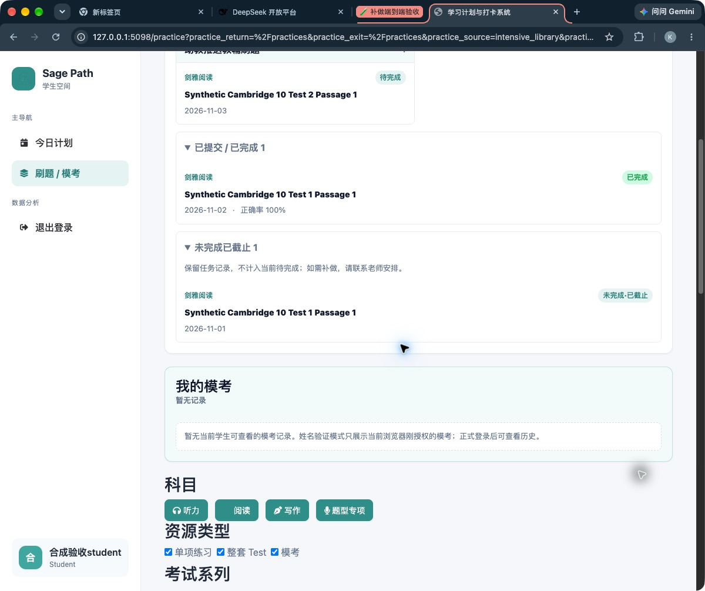

# 补做顺延独立师生验收（2026-11-04）

**结论：隔离验收发现的 03:00 宽限期提前恢复缺陷已修复；用户明确批准后，业务提交 `40cd8225db1b0a5da188b1dd99d4521dc5853328` 已推送 main 并于 2026-11-04 部署成功。隔离师生流程、CI、生产只读发布核验通过；真实微信设备、真实学生恢复和下一次实际凌晨续排仍待确认。**

## 发布补充（用户批准后）

- 发布分支 `codex/recovery-cutoff-20261104`，由下述 clean 基线创建；8 个文件内容与验收候选 SHA 一致，未夹带旧主树改动。业务已 commit / push / deploy，本报告与两交接随后用独立 `[skip ci]` 文档提交同步；生产运行 HEAD 保持业务提交。
- [分支 CI](https://github.com/KB77GG/studytracker/actions/runs/41833707165)、[主线 CI](https://github.com/KB77GG/studytracker/actions/runs/41838677809)均 success，test / account-provisioning / task-planner 三测试 job 成功；仓库既有 advisory lint failure 仍保留，不称全库 lint 通过。[阿里云部署](https://github.com/KB77GG/studytracker/actions/runs/41838677873)一次成功。
- 标准库只读脚本 [verify_release.py](verify_release.py) 核对生产 HEAD、7 个运行文件 SHA、匿名 HTTP、systemd 和告警计数；不导入 app 或查询学生表。详见 [发布核验](release-audit.json)、[断言结果](release-validation.json)、[发布前基线](predeploy-audit.json)。生产 tracked clean，113 个递归未跟踪文件数量前后相同（与旧交接按顶层入口计数的17项口径不同）。
- 服务自 **2026-11-04 21:31:05 CST** 起 active/running，NRestarts=0；127.0.0.1:5002、workers=1、gthread、threads=6。重启后 warning 以上日志计数0。公网 login200；回环 login200 / planner302到登录 / bootstrap与inbox401 / preview与apply匿名OPTIONS401 / 测试控制端点404。
- Timer enabled/active/waiting，两个 systemd unit 与仓库逐字相同，下一次触发 **2026-11-05 03:05 CST**。这只证明配置和运行状态，尚不是修复后次日业务实际续排的证据。
- 本次没有新增 schema / 迁移或手动生产数据库操作，没有为任何真实学生执行补做、跳过、提交或排程；无小程序改动、上传、提审、发布。

精确发布核验命令（cwd 为发布树；输出仅运维状态，不含学生数据）：

```bash
ssh root@47.110.45.193 'cd /root/apps/studytracker && .venv/bin/python -' < docs/reviews/recovery-e2e-20261104/verify_release.py > docs/reviews/recovery-e2e-20261104/release-audit.json
curl -L --fail --silent --show-error --max-time 30 -o /dev/null -w 'public_login_http=%{http_code}\n' https://studytracker.xin/login
```

## 基线与范围

- 隔离树：`/private/tmp/studytracker-recovery-e2e-20261104`，验收开工为 detached HEAD `f0e040416c8a68e66ba1202e558d4c1690bdc91b`、clean。已从 GitHub fetch 核对 main，批准后在同树建立上述发布分支。
- 补做业务源提交：`d636398e54a59ecbe123ad20f39275e24c5c2fa0`。上述基线中的 recovery、planner、planner API 与该提交相同，另包含 11 月 3 日已上线的学生当前任务列表改进。
- 主资料树：`/Users/zhouxin/Desktop/studytracker`，`main@6ded77d24586327ad94e151e172ae4811b4a2eed`，behind origin/main 103；原 7 modified / 22 untracked 入口保留。业务修复仅在隔离树，资料树只有本报告镜像和两交接增量。
- 使用新建临时 SQLite、合成账号和合成阅读题目；真实 Flask app、登录、助教鉴权/CSRF、学生接口、判分、数据库事务和 `run_due()`。没有用直接设置 done 或插入结算记录冒充本次端到端学生完成。
- 隔离验收替换范围仅配置、题目目录和业务时钟；外网、通知被阻断。没有读取生产库、真实学生、`.env` 或密钥，没有微信登录、微信消息或付费 API；批准后的发布只读运维核验另见上节。

## 已确认缺陷与修复

原实现仅以 `source_date < today` 判断是否可恢复，未衔接学生次日 03:00 截止时间。真实接口复现见 [baseline-grace-race.json](baseline-grace-race.json)：

1. 11 月 1 日已布置的阅读未完成；11 月 2 日 **02:59**，原任务仍可写，但助教收件箱已出现，预览允许补做。
2. 助教确认生成新补做任务；学生 **02:59:30** 通过真实阅读提交接口完成原任务，HTTP 200、13/13，原任务变 done。
3. 11 月 3 日 **03:05** 执行真实排程：eligible=1、published=0、blocked=1，原因是额外生成的补做仍未完成。即合法宽限期内完成原作业，仍被要求重复补做并停排。

候选修复：

- `services/task_planner_recovery.py` 复用既有 `task_date_cutoff_local()`；仍在截止时间内的来源日不进入待处理收件箱，makeup/continue 的预览和直接 apply 均返回 **409 / source_still_open**。
- **03:00 整点**可恢复，学生原任务同一时刻转只读；更早积压在当天 03:00 前仍可处理；已成功请求跨日重放保持幂等。
- 模板增加“原任务在次日03:00截止后进入待处理”说明；用法文档同步。没有修改成绩、旧数据、自动开关、03:05 调度时间或数据库结构。
- CI 将新增截止回归加入现有 planner job，将真实师生 API 旅程加入已有真实 app 依赖 job；发布分支和主线云端 CI 已运行并通过相应步骤。

完整差异见 [candidate.patch](candidate.patch)。修复前新增 11 个截止测试方法中，6 个方法失败（9 个失败断言/子测试），5 个正向方法通过；修复后全通过。详见 [baseline-cutoff-tests.log](baseline-cutoff-tests.log) 和 [coverage-review.md](coverage-review.md)。

## 本次新增验证结果

| 完整场景 | 本次证据与结果 |
|---|---|
| 助教发现→预览→确认→学生提交→次日续排 | 真实 API 旅程通过；Chrome 另外从登录与姓名验证、真实页面点击、13 题填写提交走完整链路 |
| 预览不写库、重复确认 | Task/PlanItem/decision 数量不变；同请求返回同结果，不重复顺延 |
| 03:00 宽限 | 02:59:59 原作业可提交、昨日未截止不能恢复；03:00 原提交返回403 task_expired，助教可恢复；本地、UTC、naive UTC 边界通过 |
| 03:05 排程 | 03:04:59 outside_window；03:05 新内容发布；再次执行 published=0；正常宽限提交可无需补做而续排 |
| 连续多天未完成 | 连续三次补做形成明确来源链，收件箱只列最新待完成；完成最新补做后恢复新内容 |
| 阅读整套 | 同 Test 三篇 13+13+14=40 题分别通过真实接口提交；全部完成后次日发布下一完整三篇 |
| 整套只完成2/3 | 次日三条后续 entry 一起 blocked；只补剩余 P3，完成14题后下一日发布三篇新内容 |
| 只剩 P2 | 仅生成一条 P2 补做；原 P1 的0分、P3的满分及其原始成绩记录逐字段保留 |
| 原数据保留 | 原 Task、PlanItem、ReadingTestSubmission、PracticeSubmissionAttempt、ScoreRecord 全字段内存比较一致；不导出能力令牌 |
| 其他学习线 | 所选线恢复不改变另一线已发布任务、未发布 entry 与开关；另一线仍按自己的规则自动发布 |
| 忽略本次 | 不改原任务完成状态；当天原安排发布，下一天未完成仍会挡住后续，未永久取消等待规则 |
| 当天已发布保护 | 预览明确阻止补做，不撤回已发布任务；学生仍可完成当日新作业 |
| 学生端可见和隔离 | 网页当前任务可打开；小程序真实 today/detail/cambridge API 返回补做三篇40题；新旧 token 不混用，跨学生访问受限，新补做 submission 为空 |

新增 **22 个 Python 测试方法**：9 个真实 app 业务旅程、2 个学生端接口契约、11 个截止服务/API 回归。它们与原 recovery 26 项做一次最终组合，**48/48 通过（15.338s）**。原 recovery 前端 **16/16** 定向回归通过。

历史“335项”是 11 月 2 日记录的 planner160 + recovery26 + 旧回归71 + Node78，不是335个端到端流程，也不是本轮新增数量。本轮未重新跑全部335项；26项与16项仅因修改恢复边界而作定向回归。原子回滚、资源重复等旧测试仍是已有证据，不冒称本次新增。

## 实际 Chrome 师生链路

使用 127.0.0.1:5098 的临时服务与同一个合成库，业务时钟起于 11 月 2 日10:00：

1. 合成助教通过真实 `/login` 进入 `/task-planner`；看到11月1日未完成，预览11月2日补做、后续分别移到11月3/4日，点击确认。
2. 切换合成学生并经过实际姓名验证页面；当前任务只显示新补做，打开题目为空白，逐题填入13个答案并点击提交判分。
3. 页面显示13/13、100%、已同步任务；任务列表显示补做已完成，原11月1日仍“未完成·已截止”。
4. 通过仅测试模块注册的控制端点推进到03:04:59/03:05，执行真实 `run_due()`，结果见 [browser-scheduler.json](browser-scheduler.json)。这一步是受控执行，**不是等到真实凌晨或调用生产 systemd**。
5. 刷新学生页，出现11月3日 Test2 P1；实际打开后13题为空白、提交按钮可用。



另有 [影响预览](browser-preview.png)、[补做完成及历史](browser-completed-and-history.png)。浏览器 DOM 导航工具出现接口错误后，使用同一 Chrome 的原生可访问性操作完成流程；没有注入假 fetch 或替换页面响应。未收集可靠完整 console 日志，不声称控制台零错误。

体验备注：学生网页卡片显示内容、日期与状态，未直接标“补做”；补做说明保存在 note，小程序详情可见。任务关联与可操作性已验证，此展示差异未作为阻断项，也未扩大本次修复。

## 复跑与验证

在隔离树执行（Python 使用主资料树现有 `.venv`）：

```bash
TZ=UTC PYTHONDONTWRITEBYTECODE=1 /Users/zhouxin/Desktop/studytracker/.venv/bin/python -m unittest tests.test_task_planner_recovery_e2e tests.test_task_planner_recovery_student_contract_e2e tests.test_task_planner_recovery_cutoff tests.test_task_planner_recovery -v
node --test tests/test_task_planner_recovery_client.js
/Users/zhouxin/Desktop/studytracker/.venv/bin/ruff check --no-cache services/task_planner_recovery.py tests/recovery_e2e_support.py tests/test_task_planner_recovery_cutoff.py tests/test_task_planner_recovery_e2e.py tests/test_task_planner_recovery_student_contract_e2e.py
git diff --check
```

日志：[final-python-tests.log](final-python-tests.log)、[recovery-client-tests.log](recovery-client-tests.log)。Ruff、5个Python文件的Python3.10 AST解析及Jinja模板解析通过；没有把AST兼容检查当作Python3.10运行测试。

基线反例可独立重现：

```bash
TZ=UTC PYTHONDONTWRITEBYTECODE=1 /Users/zhouxin/Desktop/studytracker/.venv/bin/python docs/reviews/recovery-e2e-20261104/reproduce_baseline.py --output docs/reviews/recovery-e2e-20261104/baseline-grace-race.json
```

此命令固定读取 `f0e04041` 的 recovery 源码，仅在内存替换，退出时还原，并检查候选源码SHA未变；**退出0表示缺陷成功复现，不表示基线验收通过**。

浏览器夹具：`TZ=UTC PYTHONDONTWRITEBYTECODE=1 /Users/zhouxin/Desktop/studytracker/.venv/bin/python -m tests.recovery_e2e_support --serve`，仅访问 `http://127.0.0.1:5098/__e2e`。测试控制路由仅由该独立模块注册，生产 app 不会注册。退出后删除临时库与随机合成凭据。

## 仍待确认与发布状态

- **待真机**：iOS/Android 微信 WebView 打开补做链接、返回小程序后状态刷新、会话过期/重新登录、切后台恢复、真实网络断开重试。小程序 API 通过不等于原生界面或 WebView 已验。
- **待真实运行**：观察修复部署后实际03:05 systemd触发、日志与当日任务。线上运行 HEAD 和 timer 已只读核验；受控排程通过与生产定时器配置正确均不能替代真实次日业务观察。
- **待真实学习流**：须由助教选定并授权具体学生，才能观察真实恢复后的体验；本轮没有替任何真实学生作补做或跳过决定。
- 新增旅程以阅读单篇/整套为主；词汇真实训练结算、精听音频/录音及所有任务类型的完整微信流程未新增覆盖，旧相关单元结论不升级为端到端结论。
- 受控时钟覆盖业务日期、截止判断和阅读提交时间；ORM默认审计时间保留墙钟，未改变操作系统时钟。
- 已关闭本次浏览器标签页，服务退出0，5098无监听，临时库及目录已删除，见 [cleanup.json](cleanup.json)。
- **业务修复已 commit / push / deploy；报告及规范交接随独立文档提交同步到远端。小程序未上传 / 提审 / 发布，未操作真实学生任务。**
- 下一位 agent 先读取规范交接并核 Git 状态；若开展真实验收，仍须由助教选择和授权具体学生。可只读观察下一次生产 timer 结果；真机链路由实际 iOS/Android 微信设备确认，无需重复已完成的隔离旅程。
