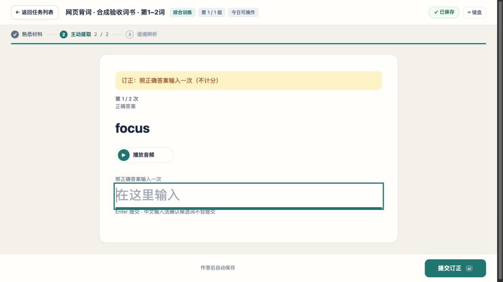

# Claude 审查后的修复记录

审查基线为已推送的 `f804998f`（产品提交 `2f83ebd1`）。继续使用 `/private/tmp/studytracker-web-vocabulary-20261126`、`codex/web-vocabulary-task-page-20261126`，本轮仅修复、补测、推该分支并等 CI。main、生产部署及开关均不动。

## 逐项处理

| 审查项 | 处理与边界 |
|---|---|
| 1. HTTPS 代理下 Origin 被拒 | 合法 HTTP/HTTPS Origin 按域名及端口匹配 `request.host`，不再匹配内部 `request.scheme`；仍检查 CSRF、身份与归属。未信任 Forwarded 头，畸形来源、不同主机/端口等仍拒绝。测试复现 HTTPS Origin + HTTP 内部请求；没有访问生产，所以不声称原线上代理配置一定会触发。 |
| 2. 刷新计时归零 | 采纳低成本修复：按任务与学生身份在本浏览器保存首次进入时间，保持“本端进入至首次结算”的墙钟口径，不引入主动学习时间算法。不同任务/学生隔离；离页间隔仍计入，不把它称为净学习用时。 |
| 3. 请求体大小限制 | 用 `request.stream` 有界读取，最多 16 KiB + 1 个探测字节；声明超限先拒，未知长度/分块传输在服务器明确流边界时也受限制，不再先整包读取。没有长度且没有 WSGI EOF 标志时保留安全空流并返回 400；应用不能越过 WSGI 的报文边界去探测下一请求。 |
| 4. 进行中排序 | 派生 active 词汇任务的排序与已有进行中任务一致，且不写 Task.status；非词汇任务沿用原排序键。 |
| 5. 查询和标题 | 列表批量读取词书标题，列表/详情共用一份标题与范围规则；保持自定义标题优先和原四类任务优先级。 |
| 6. app.py 接入过多 | 词汇专属 payload、状态、排序及批量查询移到主题 service，app.py 仅做查询/委托接入；不靠压行缩短代码。 |

旧验收及上一轮 CI 证据继续保留。当前 34 文件冻结在 `review-fix-manifest.json`，其中 11 文件相对已审基线变化；没有新模型、迁移、配置或小程序前端变更。`app.py` 相对 `f81a5e4` 为 **+14/-3**。计时模块 315 行、page 模块 379 行，无新增模板依赖。

本轮计时独立复核曾发现：A 页因未完成而恢复计时后，B 页的旧内存快照会将秒数写回。现使用代次标记，使旧代次快照不能覆盖新一轮计时，并加入任务/复习双实例以及存储失效恢复回归。仍保留内存回退：禁用或清空本地存储后无法保证跨刷新延续；不同浏览器、设备不共用计时。首次结算尝试固定本端秒数，网络重试不增长；服务端明确拒绝未完成时才恢复累计。已保存结算仍由服务端只读重放，不改原成绩/用时。

请求体测试覆盖声明超限零读取、未知/虚假长度、分块/短读、恰好16 KiB、缺少安全流边界、截断/非JSON等。WSGI声明的报文边界是安全上限；未擅自读取原始input探测后续请求。批量查询的“1+1”仅指新增词书和flow查询，公共日期/工作流仍可能读取既有关联PlanItem，不声称整个列表仅两条SQL。

## 本轮验证

| 验证 | 结果 |
|---|---|
| Python 3.13 合并回归 | 242/242，34.702s |
| Python 3.10 合并回归 | 242/242，38.378s；沿用已披露的旧测试UTC别名入口 |
| 日期门禁 pytest | 两版本各20/20，各0.35s |
| Node 新页面＋原列表/导航/反馈 | 66/66，其中新页面39 |
| 原生Python 3.10产品编译 | 10文件通过，无UTC别名 |
| 新Python/测试Ruff、变更JS语法、diff check | 通过 |
| A02 | 固定历史fixture/生成脚本/快照未改，新旧off/on仍完整匹配 |

本轮新增12个Python测试（路由6、列表/metadata6），新增8个Node计时测试。完整argv/cwd及日志见 `validation/review-fix-commands.json`，原20模块列表继续全部执行；小程序分组接口10项、判分6项仍通过。定向测试日志 `review-fix-request-gates-final-*`、`review-fix-list-*`、`review-fix-frontend-node.log` 另存，未覆盖原验收日志。

## 浏览器证据

使用 `serve_fixture.py` 的合成学生、内存SQLite与本地音频，IAB应用内浏览器实际操作：错答 depend → 待订正 → `tab.reload()` → 同题/正确答案/第1次订正仍在 → 输入正确答案后进入下一题。最终脚本完成后又对 focus 待订正状态刷新，仍停在原题，未跳过。证据为 `validation/review-fix-correction-reload.json`、`review-fix-correction-final-reload.json` 与下图。

这是真浏览器页面reload，但不是物理F5、Chrome/Safari或真实输入法测试。Chrome控制接口本次导航失败，Mac原生应用控制显示锁屏，未把它们记成通过。没有修改系统输入法/缩放/网络设置；测试IAB标签已关闭，5111本机服务器已停止，无生产操作。测试服务不部署。

## 提交与CI

当前为待推候选；本轮修复将在同一任务分支提交/推送，取得新CI结果后补记。此前2f83ebd1的CI仍是历史证据，不能代表本轮修复版本。

## 启用门槛

本轮不部署、不启用。上一轮 `branch-review.md` 的真设备清单继续适用；自动测试不会替代系统输入法/长按、真实断网及网络层丢响应、手机互切、原生缩放、老师家长界面等实测。若本轮实际补到浏览器项目，会单独记录浏览器、操作及证据范围。
